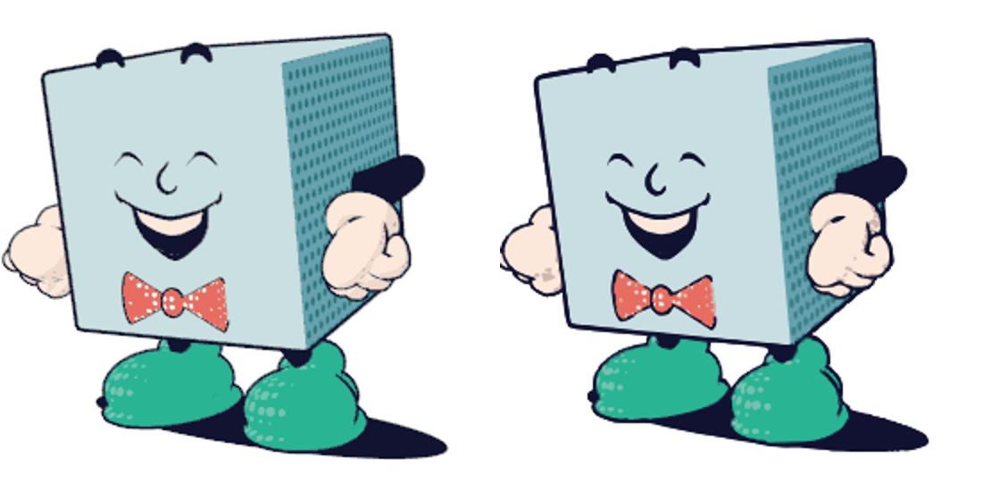

# gif-to-lottie

Turn a GIF into a [Lottie](https://lottiefiles.com/what-is-lottie) animation made of real vectors that stay crisp at any size.



*Left: the original GIF. Right: the traced Lottie.*

```bash
pip install -r requirements.txt
python gif_to_lottie.py in.gif out.lottie          # zipped dotLottie
python gif_to_lottie.py in.gif out.json            # plain Lottie JSON
python gif_to_lottie.py in.gif out.lottie --step 2 # animate on twos
```

The defaults are tuned for flat-colour art like cartoons, emoji and pixel art. Photos won't work well.

## How it works

The output is a flipbook: each GIF frame becomes one vector layer, shown for exactly that frame's delay. For each frame:

1. **Snap to the real palette.** The GIF's actual colours are found automatically: a colour counts if it forms solid 2×2 blocks. Anti-alias blends and white matte fringe only ever sit in 1px bands along edges, so they drop out. Each blend pixel then takes the colour of its closest neighbour.
2. **Screen-print layers.** One mask is traced per colour and the masks are stacked. Each layer reaches a little way under the layers above it, so no hairline gaps show between colours.
3. **A separate ink pass.** Rendered outlines are thin anti-aliased strokes that rarely reach full black, so palette snapping loses them. Line art is detected as thin, unsaturated pixels darker than their surroundings, and traced as a top layer.
4. **Halftone dots become circles.** Small round blobs are written as Lottie ellipses instead of traced beziers. They're smaller in the file and perfectly round.
5. **Smoothing.** Pixel stair-steps are simplified with Ramer–Douglas–Peucker and refit as Catmull-Rom curves. Sharp turns stay as real corners.

Run `python gif_to_lottie.py --help` to see the settings (`--upscale`, `--ink`, `--dots`, `--smooth`, `--step`, ...).

## Trade-offs

- **Size:** a flipbook redraws every frame, so the output is usually bigger than the GIF. Example: `examples/marty.gif` is 1.3 MB and `examples/marty.lottie` is 3.3 MB.
- **Speed:** frames are traced at 3× in parallel. A 58-frame 480×480 GIF takes a few minutes.
- **Motion:** shapes aren't keyframed between frames. It's a vector flipbook, not a rig.
